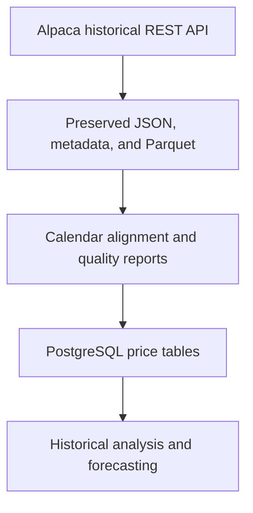

# Stock Market Analysis and Forecasting

A Python and PostgreSQL project investigating technology-stock performance, shared market risks, and whether market and sector information improves forecasts of afternoon stock returns. The project prioritizes preserved source data, documented quality checks, and chronological evaluation against simple baselines.

**Status:** Full historical collection, validation, database loading, and descriptive analysis are complete for January 2020 through September 2026. Intraday forecasting is the next phase; no forecasting results are available yet.

Last progress update: November 4, 2026 (America/New_York).

## Research questions

- Which stocks delivered stronger historical returns, and with what volatility and drawdowns?
- How closely do the selected stocks move together and with market and sector benchmarks?
- What shared risks and historical factor exposures characterize this stock universe?
- Does adding market and sector information improve afternoon-return forecasts over stock-only inputs and appropriate baselines?

Actual portfolio profit and loss requires transaction dates, quantities, and prices. This project initially analyzes the selected securities rather than reconstructing account performance.

## Scope

Historical collection: **January 1, 2020 through September 30, 2026**, inclusive; 15 tickers, one-minute bars, historical SIP feed, and unadjusted source prices. This is six complete years plus nine months, or 81 calendar months and 1,215 ticker-month batches.

| Role | Tickers |
|---|---|
| Stock prediction targets | AMZN, MSFT, NVDA, AMD, GOOGL, META, TSM, MU, ORCL, AVGO |
| Broad market benchmark | SPY |
| Information technology benchmark | XLK |
| Semiconductor benchmark | SMH |
| Consumer discretionary benchmark | XLY |
| Communication services benchmark | XLC |

The ETFs are market and sector proxies, separate from Fama–French factors. They may hold the stocks under analysis, so benchmark inputs are not independent outside forces. TSM refers to its U.S.-listed security.

The original six-observation design uses 9:30, 10:48, 12:06, 13:24, 14:42, and 16:00 Eastern on normal sessions. These derived observations are **not implemented yet**. We preserve underlying minute bars so exact sampling and availability rules can be defined without redownloading. A bar labelled 13:24 cannot be assumed fully available at 13:24; bar-start and bar-end timing must be respected.

## Architecture



| Tool | Purpose |
|---|---|
| Python / VS Code | Ingestion, validation, loading, and analysis code |
| requests | HTTP API requests |
| pandas / NumPy | Tabular processing and numeric checks |
| PyArrow / Parquet | Typed source-data snapshots |
| PostgreSQL | Structured storage, constraints, joins, and SQL calculations |
| pgAdmin | Database inspection and SQL interface |
| psycopg | Python connection to PostgreSQL |
| python-dotenv | Local environment configuration |
| pandas-market-calendars | Session schedules and trading-minute expectations |

PostgreSQL is installed locally and accessed through pgAdmin and Python. Docker is optional and has not been added. Jupyter is planned for exploration and communicating analysis.

## Verified progress

### Environment and connectivity

- Created a project Python 3.13 virtual environment on macOS.
- Installed dependencies and recorded versions in `requirements.txt`.
- Connected Python to the `stock_market_analysis` database.
- Stored local credentials in `.env`, excluded through `.gitignore`.
- Successfully retrieved historical SIP minute bars using the configured Alpaca account.

### Single-session sample

Downloaded MSFT for January 6, 2025, regular session:

- 390 one-minute bars, from 14:30 through 20:59 UTC.
- Preserved API response body, Parquet table, and request metadata.
- Verified Parquet read-back against the in-memory downloaded table.
- Found no duplicate or invalid timestamps, missing expected minutes, missing fields, invalid prices, impossible OHLC relationships, or negative volume in the implemented checks.
- Loaded 390 records into PostgreSQL.
- Repeated the sample load: 0 inserted and 390 existing keys skipped.

Sample snapshot: `20261103T030011526837Z`.

### Five-ticker pilot

Requested January 6–10, 2025, inclusive, for MSFT, NVDA, SPY, XLK, and SMH. Pagination downloaded 15 response pages. The saved calendar contained four regular sessions: January 6, 7, 8, and 10.

| Ticker | Downloaded bars | Regular-session bars | Outside scheduled regular sessions |
|---|---:|---:|---:|
| MSFT | 2,398 | 1,560 | 838 |
| NVDA | 3,838 | 1,560 | 2,278 |
| SPY | 3,213 | 1,560 | 1,653 |
| XLK | 1,844 | 1,560 | 284 |
| SMH | 1,992 | 1,560 | 432 |
| **Total** | **13,285** | **7,800** | **5,485** |

**Correction to an earlier progress summary:** the ticker counts sum to 13,285 downloaded bars and 5,485 outside-session bars. Earlier conversation totals of 13,155 and 5,355 were arithmetic errors; individual ticker counts and the 7,800 regular-session total are unchanged.

Validation established:

- 1,560 expected regular-session minutes per ticker.
- 100% regular-session minute coverage for each pilot ticker.
- All five tickers present at the same 1,560 expected timestamps.
- Zero invalid timestamps, duplicate timestamps, invalid price rows, invalid OHLC rows, invalid volume rows, or rows with missing fields in the implemented report.
- Outside-session records preserved in raw storage rather than treated automatically as errors.

The pilot loader rechecked regular-session inputs, compared existing database values, and committed one transaction across all five tickers:

| Ticker | New rows inserted | Existing identical rows |
|---|---:|---:|
| MSFT | 1,170 | 390 |
| NVDA | 1,560 | 0 |
| SPY | 1,560 | 0 |
| XLK | 1,560 | 0 |
| SMH | 1,560 | 0 |
| **Total** | **7,410** | **390** |

SQL verification confirmed **7,800 database rows**, with 1,560 per ticker. Existing MSFT records retained their original source snapshot. A conflicting existing value causes the pilot load to fail rather than silently overwrite data.

Pilot snapshot: `20261103T040043189419Z`. UTC snapshot names fall on November 3 while the work occurred on November 2 Eastern.

## Historical collection and validation

`config/full.json` defines the expanded universe and date range. The provided `scripts/download_full.py` implementation:

- Splits requests into ticker-month batches.
- Downloads all response pages with a 10,000-record page limit.
- Retries selected temporary errors and respects `Retry-After`.
- Paces requests and records request parameters and response times.
- Preserves original response bodies, metadata, and Parquet records.
- Verifies Parquet round trips before marking a batch complete.
- Stores a SHA-256 checksum for each completed batch.
- Skips completed batches after verifying their checksums.
- Starts a new attempt for unfinished batches without overwriting earlier attempts.
- Separates collections using a configuration hash.

The full collection has been completed and audited. Across 1,215 ticker-month batches, 14,957,102 minute bars were downloaded. The download audit passed for every batch. Validation identified approximately 0.258% missing expected regular-session ticker-minutes; those minutes were not filled. Some gaps align with marketwide trading halts, while other sparse sessions remained unresolved after direct API rechecks. The full validation reports and session exclusions are preserved under `reports/full/` and `config/session_exclusions.csv`.

Changing configuration creates a different collection and does not reuse overlapping months from another configuration. A completion marker means download completion, not analytical acceptance.

### Database load

- Loaded 9,857,840 regular-session minute bars into PostgreSQL.
- Loaded 76,275 daily records covering raw, split-adjusted, and split-and-dividend-adjusted prices.
- Preserved source data and validation reports for traceability. Passing validation checks does not independently establish that every provider price is correct.

## Historical analysis results

The descriptive analysis covers 10 stocks and 5 ETF benchmarks from January 2020 through September 2026. Daily returns were compared over 1,694 matched return dates. The figures are in [`reports/figures/`](reports/figures/).

### Methods

Performance analysis uses split-adjusted closing prices and excludes dividends. It calculates daily returns, indexed price performance, maximum drawdown, annualized volatility, Pearson correlations, and market-model beta and R². Annualized volatility is the sample standard deviation of daily returns multiplied by √252. Drawdowns use running peak closing prices within the observed dataset.

### Findings

- NVDA had the largest cumulative price gain in the sample (+3,707.60%) and a maximum drawdown of 66.36%.
- META had the deepest maximum drawdown (76.74%).
- SPY had the lowest annualized volatility among the 15 tickers (19.79%).
- Each stock had a higher full-sample return correlation with its assigned sector ETF than with SPY.
- Market beta varied by year, so a single full-period estimate can obscure changes in sensitivity.

### Figures

- [`indexed_price_performance.png`](reports/figures/indexed_price_performance.png)
- [`stock_vs_spy_panels.png`](reports/figures/stock_vs_spy_panels.png)
- [`stock_vs_spy_drawdowns.png`](reports/figures/stock_vs_spy_drawdowns.png)
- [`return_vs_volatility.png`](reports/figures/return_vs_volatility.png)
- [`daily_return_correlations.png`](reports/figures/daily_return_correlations.png)

### Limitations

- Missing expected regular-session minutes were not filled. The causes of some sparse sessions remain unresolved after rechecks.
- Results describe selected current holdings and benchmarks, so selection and survivorship bias apply.
- Returns exclude dividends, transaction costs, and taxes. The 2026 sample covers January through September only.
- Same-day correlations and historical R² describe association and fit; they do not establish forecasting accuracy.
- January–September 2026 has already been viewed descriptively and must not be presented as a completely unseen holdout.

## Repository layout

```text
config/
  pilot.json
  full.json
  daily.json
  session_exclusions.csv
scripts/
  download_sample.py
  inspect_sample.py
  load_sample.py
  download_pilot.py
  validate_pilot.py
  load_pilot.py
  download_full.py
  audit_download.py
  validate_full.py
  load_full.py
  download_daily.py
  validate_daily.py
  load_daily.py
  recheck_sparse_sessions.py
  plot_indexed_performance.py
  plot_stock_vs_spy.py
  plot_drawdowns.py
  plot_return_vs_volatility.py
  plot_return_correlations.py
sql/
  create_price_bars.sql
  create_daily_prices.sql
  create_daily_price_returns.sql
reports/
  full/                 # Download audits and validation outputs
  daily/                # Daily-price quality reports
  figures/              # Historical-analysis charts
tests/
  check_connection.py
  check_market_data.py
requirements.txt
.gitignore
.env                 # Local only; never commit
```

Files under `tests/` currently serve as manual connectivity checks, not a comprehensive automated test suite. Sample and pilot scripts contain fixed snapshot identifiers.

## Local setup and execution

Use Python 3.13 and an available local PostgreSQL server. Create a virtual environment from the project root:

```bash
python3.13 -m venv .venv
source .venv/bin/activate
python -m pip install -r requirements.txt
```

Create a local `.env` with your own values:

```dotenv
PGHOST=localhost
PGPORT=5432
PGDATABASE=stock_market_analysis
PGUSER=postgres
PGPASSWORD='replace_locally'
ALPACA_API_KEY='replace_locally'
ALPACA_SECRET_KEY='replace_locally'
ALPACA_DATA_URL=https://data.alpaca.markets
```

Do not commit `.env`, virtual environments, or API credentials. `.env` is plain text, not encrypted. The current local setup uses the `postgres` role; a dedicated project role is a future improvement. Keep downloaded market data local unless redistribution is permitted by the provider's terms.

Create the database in pgAdmin and run `sql/001_create_price_bars.sql` against it. Then check connectivity:

```bash
python tests/check_connection.py
python tests/check_market_data.py
```

The collection has completed. The following commands show the implemented download, audit, validation, load, and daily-price workflows; rerun them only when intentionally creating or processing a collection:

```bash
python scripts/download_full.py
python scripts/audit_download.py
python scripts/validate_full.py
python scripts/load_full.py
python scripts/download_daily.py
python scripts/validate_daily.py
python scripts/load_daily.py
```

The full download can be resumed with the same configuration: completed batches are checksum-verified and skipped, while unfinished batches can be retried.

## Database design

`market.price_bars` stores multiple tickers in one shared table. Its primary key combines ticker, bar timestamp, timeframe, provider, feed, and adjustment. The table includes OHLC, volume, trade count, VWAP, and a source-snapshot reference.

- `TIMESTAMPTZ` identifies an instant; display timezone can vary by session.
- Constraints enforce selected price and volume rules.
- Source snapshots support traceability without modifying preserved files.
- Additional validation is necessary: database constraints alone do not cover every nonfinite value or business rule.

## Next phase: intraday forecasting evaluation

Initial unit: one stock on one trading day. Initial target: return from a documented cutoff price at 13:24 Eastern to a documented regular-session closing-price proxy. Exact bar availability, close definition, shortened-session exclusions, and unchanged-return handling remain to be frozen.

| Stage | Models / comparisons | Metrics |
|---|---|---|
| Initial regression experiment | Zero-return baseline; Ridge with stock-only versus stock-plus-ETF inputs | MAE primary; RMSE secondary; relative MAE improvement |
| Regression extensions | Ordinary linear regression; shallow decision-tree regressor | Same return-error metrics |
| Classification extension | Logistic regression versus training-frequency constant-probability baseline | Log loss, calibration, directional accuracy |

Candidate features include prior returns, morning return/range, relative volume, recent volatility, and market/sector moves available by the cutoff. A Fama–French analysis has not been completed; any later forecasting use must respect factor publication availability.

Before model comparison:

- Freeze chronological training, validation, and final-test boundaries in a versioned evaluation plan. Since January–September 2026 has already been viewed descriptively, it is not an unseen holdout; choose a defensible test period and document any prior exposure.
- Keep all stocks from each date in the same split.
- Fit preprocessing and scaling on training data only.
- Verify feature availability and rolling calculations, not just timestamp labels.
- Tune on validation periods and evaluate the selected approach once on a final period not used for model selection or fitting.
- Estimate uncertainty in paired performance differences using consecutive blocks of trading dates, keeping stocks together.
- Report results by stock and period, including null or negative findings.

MAE and RMSE measure prediction error; they are not margins of error. Confidence intervals for evaluation metrics are separate from individual prediction intervals. No 53–56% directional-accuracy guarantee or universal industry target is assumed.

## Limitations and next steps

The universe was selected from current holdings and is concentrated in technology-related businesses. Findings cannot automatically generalize to other securities. Stocks share trading dates and market movements, so rows are not independent observations. Minute bars do not create millions of independent forecast targets. Historical bars may be revised, and final historical aggregates do not by themselves reproduce live availability at a precise cutoff.

Forecasting accuracy does not establish trading profitability. No trading strategy, transaction-cost model, or execution simulation has been implemented.

- [x] Environment, database, and API connectivity
- [x] Single-session ingestion, preservation, validation, and loading
- [x] Pilot pagination and Parquet verification
- [x] Pilot calendar alignment and quality reports
- [x] Pilot database load with overlap comparison
- [x] Complete and audit full minute-bar collection
- [x] Validate full collection and investigate/recheck sparse sessions
- [x] Load regular-session minute bars and daily price versions into PostgreSQL
- [x] Document the historical split-adjusted, dividend-excluded return convention
- [ ] Define corporate-action handling for intraday forecasting features and targets
- [ ] Add meaningful automated failure/recovery and leakage checks
- [x] Produce historical findings and descriptive charts
- [ ] Freeze evaluation plan and run baseline-versus-Ridge comparison
- [ ] Add model extensions if the core work is complete

Update this README only with measured results and explicit limitations. Preserve failed or excluded-data evidence instead of silently dropping it, and record future milestones with the configuration and data snapshots used.
